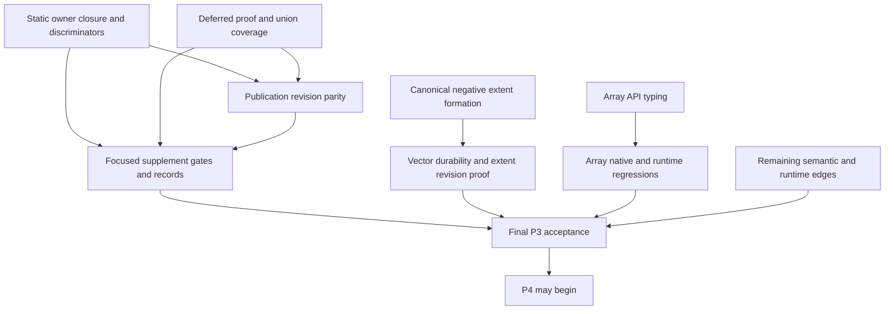

# P3 inference-owned publication: implementation findings and continuation report

Date: 2026-10-08. This report captures the implementation interruption and subsequent records-only update. It explains the source already present, completed evidence, adopted solutions, remaining problems and execution order. It does not authorize a language change, certify the final tree, or replace the [checkpoint](COLL006.C1-CHECKPOINT.md) as the shared state authority.

## 1. State, scope and reliable anchors

| Item | Current fact |
|---|---|
| Branch | `feat/telos-collection-upgrade` |
| Worktree | `/Users/altunhasanli/dev/phalcom/phalcom/.worktrees/telos-collections-upgrade` |
| Original delivered foundation | `e3dfe492 feat(COLL006): advance P3 Vector foundation` |
| Later observed commit | `e5e4ac20 feat(COLL006): continue P3 sequence construction` |
| Current inspected HEAD | `298084a4 feat(COLL006): stage sequence products by inference owner` |
| Working tree | Dirty: publication continuation in checker, session and tests, plus lifecycle/report changes |
| Parent P3 | `IN_PROGRESS / PARTIAL / FOCUSED_TESTED` |
| Publication supplement | `IN_PROGRESS / PARTIAL / FOCUSED_TESTED` |
| Latest completed publication run | 14 tests passed after static owner closure |
| Latest static caller repair | Implemented and focused-tested |
| Commit/push in this records update | None |

The two later commits appeared while implementation was in progress. Inspect live history and diffs before editing; do not assume all session work remains uncommitted or that HEAD itself contains the complete continuation. No remote delivery, clean-tree or final acceptance claim follows from observing these commits.

The prior records-only interruption left the source with the known unfinished boundary work. This continuation resumed S1 and added focused static-owner closure; the supplement remains partial.

The active scope is the [publication supplement](COLL006.C1.P3-inference-publication-plan.md) to P3 T4, including its T5 static/extraction boundary. The [parent plan](COLL006.C1.P3-implementation-plan.md) still owns negative extent formation, Array typing, Vector durability and the other P3 acceptance work.

## 2. What is already established

Earlier P3 work provides exact shared static integer identity, metadata schema 12, heterogeneous complete/partial static arguments, source-owned `Vector<T,N: Int>`, immutable dense Vector storage, checked exact tuple/Vector spreads, direct Vector bytecode and builder finalization. These are inherited foundations, not features to redesign during publication closure.

The continuation preceding this supplement removed inactive bracket synthesis, corrected family explanations, checked ordinary element compatibility, and added negative/nonpublication coverage for fixed contextual slots. A lone native Vector spread can use `VectorIdentitySpread` when its canonical symbolic extent is identical to the result extent. Compiler projection verifies that proof and emits `CopyVector`; execution copies immutable storage. This does not establish symbolic arithmetic or runtime reification of N.

Completed earlier continuation evidence was: 27 collection semantic tests, 8 Vector runtime tests, 10 Array runtime tests, a current native surface artifact with 406 records, and a workspace all-targets check. Those results precede the current publication edits. They remain historical evidence for the earlier slice, not validation of every current source change.

## 3. Problem solved by the publication design

A sequence literal can establish a canonical local result before its surrounding inference owner reaches a final decision. The old direct insertion into the executable sequence index allowed a later failed generic constraint to leave usable construction facts behind.

The discriminator is a generic application accepting `Vector<T,1>` with a mandatory `T == String` constraint, called with `<Int,1>[1]`. Its fixed return remains Int even when the application fails. Retaining that useful return knowledge is existing epistemic behavior; it cannot authorize an executable argument construction.

The initial regression failed specifically because the dependent sequence resolution survived. Its valid twin passed. This established a publication lifetime defect rather than a parse error, unsupported literal or selector mistake.

The adopted solution stages locally valid canonical products privately. Every actual contextual inference premise contributes an owner gate. Publication requires all gates to accept after final proof/materialization and status checks. A rejection discards only dependent candidates; independent siblings and independently checked declarations remain.

## 4. Implemented architecture and takeover map

| Owner/source | Present implementation | Why it matters |
|---|---|---|
| `checker/sequence_publication.rs` | Query-local owner registry, pending canonical payloads, terminal receipts and dependency sets | One lifetime authority for List/Array/Vector executable construction facts |
| `checker/context.rs` | Context/frame registration, staging, local lookup, acceptance/rejection/disposal, deferred readiness and artifact-settlement guard | Final owner decisions are explicit rather than inferred from solver cleanup |
| `checker/inference.rs` | Ordered frame identity and narrow constraint-count inspection | Stable private owner keys and exact mandatory-constraint ranges; no new solver |
| `checker/typed_expr.rs`, `composition.rs` | Private publication dependencies carried through required operand composition | Dependent element/cardinality facts preserve their actual premises |
| `checker/expression.rs` | Explicit contextual provenance input, inference-owner capture, contextual child propagation and pending explanation lookup | A Proper expected type can still be provisional; explanations remain useful before commit |
| `checker/sequence_literal.rs` | Stage canonical products; settle explicit-head owners after final local checks; cleanup early exits | Local formation cannot bypass outer ownership |
| `checker/statement.rs` | Delay annotation-owner disposal until initializer reconciliation and final acceptance | A solve alone does not establish a valid declaration |
| `checker/call.rs` | Generic argument owner provenance, final call settlement, deferred readiness extraction and union-scope settlement | Intermediate solves and known fallback returns do not commit arguments |
| `checker/row_inference.rs` | Owned extraction of row bindings/proofs; shared row proof and materialization helpers | Deferred children retain premises that otherwise disappear with the application view |
| `checker/static_body.rs` | Owner settlement before extracting committed sequence maps; artifact-settlement checks | Static products must capture post-settlement maps |
| `session.rs` | Latest same-checker partial static annotation repair | Annotation and initializer must refer to the same live graph; not yet verified |
| `tests/semantic/foundations/coll006_c1_p3_publication.rs` | Ten focused test functions | Actual tested surface is listed below |

The pending registry lives in CheckingContext, outside shared `Rc<RefCell<InferenceCoordinator>>` handles. A flow probe copies owner metadata/receipts by value and starts with fresh pending products/dependencies. `with_resolver` copies publication state coherently with its existing product-copy semantics. Neither path introduces a shared mutable publication registry.

The durable `SequenceLiteralResolution` shape and existing committed index remain unchanged by this supplement. Owner IDs, saved readiness terms and receipts remain checker-local. Compiler/VM consumers continue to receive canonical committed products.

### Owner state and settlement

Owners are Open, LocallyReady, Accepted or Rejected. A locally ready child cannot become Accepted until its registered parent gates accept. Accepted/Rejected receipts are terminal; disposal rejects unresolved owners and never means success. A late candidate can use a retained accepted receipt; a missing receipt fails closed in the registry.

The intended settlement order is:

```text
final existing parent solve
  -> validate required child readiness and mandatory obligations
  -> materialize scalar/row result and parameter requirements
  -> aggregate final causal/status decision
  -> issue terminal acceptance receipts
  -> flush eligible canonical construction products
  -> dispose the inference graph
```

The registry does not perform type solving. Deferred validation uses existing frame completion, residual obligations, row solving/materialization and declaration-conformance rules.

## 5. Important solved issues and how to preserve the solutions

### 5.1 Provisional context can already look canonical

A generic receiver such as `Consumer<Int>` can provide an argument expectation already materialized as `Vector<Int,1>`, while another method parameter or where constraint is still unsettled. Checking only whether ExpectedType is Inference would miss this dependency.

Implemented solution: generic argument entry receives an explicit private application owner alongside ExpectedType. Derived element/member expectations carry this provenance when they use that context. A focused test covers the Proper-expectation path with a later U-versus-String failure.

Do not replace this with an ambient gate on every expression visited during a call. That would discard independent nested declarations after unrelated outer failure.

### 5.2 Local child success is insufficient

A nested generic identity call can finish locally while a later parent argument creates a conflict. Implemented solution: child frames retain actual parent dependencies, and canonical products wait for both child readiness and parent acceptance. The valid/invalid nested-call pair passes.

A separate fixture checks a contextual closure tail. The tail construction is removed after outer failure, while an independent explicit Vector declaration inside that closure survives.

### 5.3 Deferred child evidence must survive its application view

A child can need ancestor evidence for its return while its argument literal is already locally valid. Waiting cannot be treated as rejection, and parent success cannot be blindly treated as child success.

Implemented solution: retain `DeferredApplicationRequirements` by value, including owner, expression/range, active parameter terms, result term/signature, mandatory constraint interval, signatures, exact argument bindings and optional row requirements. Before acceptance, inspect each required child against the existing final coordinator state. No scalar re-solve or recreated variables are introduced.

The successful deferred fixture uses `choose<T,U>(Vector<T,1>)->U` inside `use<U>(U,U)->U`, where the later witness 42 supplies U. The failed-parent fixture supplies an unresolved witness and preserves only the independent sibling. Both passed. A row-generic valid/invalid pair also passed, but a specifically deferred row-tail fixture remains to add.

### 5.4 Exact-case conformance authority must not be lost

Adviser review identified that scalar materialization can widen an exact case to its nominal domain, while the ordinary application path preserves exact argument bindings for case-specific conformance discharge. Deferred readiness must preserve the same authority.

Implemented solution: save exact argument bindings and share `exact_conformance_arguments`. During deferred conformance discharge, overlay exact cases only for parameters appearing in conformance subjects. Keep equality/subtyping governed by their registered scalar obligations; do not let a conformance refinement rewrite unrelated scalar proof.

The helper compiled in the latest completed 10-test run. That is not a discriminating behavioral test of case-only conformance. Add a positive exact-case-only implementation and a negative sibling-case control before marking this issue verified.

### 5.5 Static partial annotations had a dropped-graph caller defect

Observed reproducer: `const values: Vector<_, _> = [1]` failed with an extent diagnostic. The root cause was not a solved extent of zero. `session.rs` elaborated the partial annotation in a temporary checker, returned query-local expectation IDs, dropped that checker, then created a fresh checker for the initializer. Exact Vector extent constraints could not find the original graph.

The adviser confirmed this owning path existed unchanged at `e3dfe492`. It is a pre-existing caller-lifetime defect, but it blocks the supplement's planned static-owner acceptance evidence and therefore requires a bounded T5 correction.

Adopted Level 1 clarification: create/configure the final initializer checker, elaborate the partial annotation there once, and pass that same checker into static analysis. Preserve computed-key preparation and canonical annotation resolution on their established paths. No graph transfer, replacement variables, annotation erasure or P4 evaluator expansion is authorized.

The same-checker edit is now present in `session.rs` and is exercised by valid partial Vector/List, incompatible extent, empty underconstraint and annotation-diagnostic retention tests. Static acceptance failures now affect checked status and invalid products are removed before extraction. Missing inference sessions fail closed with an internal diagnostic; direct injected API-boundary coverage remains open.

The passing `const values: List<_> = [1]` fixture is limited evidence: List can avoid the exact-extent operation that exposed the invalid owner reference. Do not use it to claim general partial static inference is sound.

### 5.6 Representation and symbolic lowering decisions already resolved

The earlier absolute `Object <= 40` test oracle was incompatible with predecessor `5fee70c9`, whose existing inline FamilyObject already required 48 bytes on the host. Adviser guidance preserved representation and tested Vector payload against the existing largest payload. Do not reopen this as a Vector layout regression without new evidence.

The symbolic construction solution is deliberately narrow: one native Vector-storage spread, identical canonical extent, no additional operands whose effects could be lost. Runtime N interpretation and a second extent solver remain forbidden.

## 6. Completed verification and precise limits

All listed Cargo runs used `RUSTFLAGS='' RUSTC_WRAPPER=''`. No Cargo command was run for this records-only update.

| Scope | Completed result | Snapshot/meaning |
|---|---|---|
| Initial two-test publication discriminator | One expected nonpublication failure; valid control passed | Pre-fix causal baseline |
| `--lib sequence_publication` | 3 passed | Earlier registry implementation snapshot |
| `--test semantic coll006` | 29 passed | Intermediate supplement with first two publication tests; not final combined acceptance |
| `--test semantic coll006_c1_p3_publication` | 14 passed | Current publication/static-owner focused suite |
| Partial static Vector owner fixture | Failed before repair | Baseline caller defect confirmed by adviser; no passing rerun |
| `--test semantic foundations::record_row_inference` | 6 passed | Directly affected row regression suite |
| `cargo check -p phalcom-semantic -p phalcom-core --all-targets` | Passed | Current semantic/core all-targets compile check |
| `core_vector` / `core_array` | 8 / 10 passed | Consumer/runtime regressions |
| `foundations::generic_inference_proof_integrity` | 7 passed, 1 failed | Existing argument-range oracle failure remains open |
| `foundations::static_constants` | 15 passed, 3 failed | Computed-record-key diagnostics remain outside this slice |
| `cargo fmt --all -- --check` | Incomplete | Inherited dirty-worktree formatting drift; no broad format applied |
| Earlier continuation `core_vector` | 8 passed | Predates publication supplement |
| Earlier continuation `core_array` | 10 passed | Predates publication supplement |
| Earlier continuation native surface `--check` | Passed, 406 records | No native signature changes in current supplement |
| Earlier continuation workspace all-targets check | Passed | Predates publication supplement; not current-tree compile evidence |

Latest completed publication test functions:

1. `late_generic_failure_discards_dependent_sequence_and_preserves_independent_sibling`.
2. `successful_generic_and_partial_annotations_commit_sequences`.
3. `late_failure_applies_to_list_and_array_families`.
4. `canonical_generic_parameter_expectation_preserves_application_gate`.
5. `locally_solved_child_waits_for_parent_acceptance`.
6. `rejected_context_preserves_independent_declaration_inside_argument_body`.
7. `deferred_child_commits_only_after_parent_supplies_result_evidence`.
8. `failed_parent_discards_deferred_child_products`.
9. `row_generic_application_commits_only_after_row_and_type_checks`.
10. `static_partial_annotation_extracts_committed_sequence_after_solving` (List<_>).
11. `static_partial_vector_annotation_extracts_committed_sequence_after_solving`.
12. `static_incompatible_vector_annotation_publishes_no_sequence`.
13. `static_empty_partial_vector_annotation_stays_unresolved`.
14. `static_partial_annotation_diagnostics_survive_initializer_checking`.

The registry's three completed tests cover conjunction/ancestor rejection with an independent survivor, accepted terminal receipts and missing owners, and probe isolation/context disposal. This is useful contract evidence, not full coverage of cancellation, budget, ambiguity, internal failure or materialization failure through actual owner boundaries.

Not completed for this supplement: final combined collection filter; generic proof-integrity suite has one open range-oracle failure; static-constants has three outside-slice computed-key failures; new incremental parity tests; direct injected missing-owner API test; exact-case conformance discriminator; union argument coverage; scoped formatting and final diff review.

## 7. Exact restart point and remaining supplement steps

### S1 — Complete and verify static owner closure

**Highest immediate yield.** The caller diagnosis and approved correction are implemented and focused-tested; direct API-boundary injection and broader publication evidence remain.

1. Inspect the latest `session.rs` diff without replacing or resetting other checker work.
2. Compile the focused test target and correct only mechanical issues in the approved same-checker repair.
3. At expression/static entry, reject an inference expectation whose graph or active owner is missing. Expression/static entry now fails closed with an internal diagnostic; direct injected API-boundary coverage remains.
4. Report a missing owner through existing internal/incomplete diagnostics and status machinery. Do not silently turn it into context-free checking, fabricate a graph, or use fallback type knowledge as acceptance.
5. Inspect static acceptance-result propagation: the current static path ignores the Result from `accept_sequence_owner` and the Boolean settlement guard. Ensure readiness/control failures cannot leave an apparently successful checked artifact.
6. Audit annotation diagnostics: same-checker elaboration diagnostics are retained in the returned owner product and covered by a focused regression.
7. Add direct checker-boundary tests for valid partial Vector, incompatible fixed extent, underconstrained empty partial Vector, canonical List/Vector controls, and a deliberately missing owner supplied to the static API.

Assert checked construction products and status separately from evaluator results. Static collection evaluation/materialization remains P4; a P4 limitation must not be mistaken for failed checker ownership or repaired by expanding P3.

**Current S1 state:** successful checked static partial Vector commits once; invalid fixed/empty/annotation-error owners publish nothing; annotation diagnostics survive; no query-local IDs cross into durable products. Direct missing-owner injection and final static API-boundary matrix remain for S2/S4 closure.

### S2 — Finish deferred and union acceptance evidence

S2 can proceed after the owner integration is coherent; it does not require Array API redesign or centralized negative extent formation.

- Add exact-case conformance positive/negative controls using `data Status { Ready Waiting }`, a trait implemented only for `Status::Ready`, a deferred generic child and a later witness supplying unresolved result evidence. Reuse existing conformance source syntax and fixtures.
- Add a child remaining underconstrained after parent solving, and assert both status and absent construction product. A fixed return must not conceal that child incompleteness.
- Add a genuinely deferred row-tail/materialization fixture, with valid and failing controls. The current row test proves ordinary row application behavior, not every saved row-readiness path.
- Exercise union shared argument preparation: all arms valid commits the real argument once; one required arm failure discards dependent construction; independent nested declaration remains. Verify argument reuse through the existing semantic argument products rather than a production-only counter.
- Cover cancelled, budget-exceeded, ambiguous/internal and materialization failure at the lowest useful owner/registry boundary. Existing laws cover disposal, but do not justify claiming all CV-04 terminal outcomes.
- Review readiness filtering in `accept_sequence_owner`: pending dependency need is checked at the requested owner level, then descendant application records are collected. Confirm the selected children are exactly the readiness obligations required by the application, without accidentally rejecting an unrelated independent child. This is an unresolved review obligation, not a demonstrated failure.
- Verify explanation products for a locally formed but later rejected candidate retain correct family/type/cause information without entering the executable index.

**Done when:** supplement CV-01 through CV-09 have discriminating evidence, including deferred proof and union paths, with no oracle weakening or new inference semantics.

### S3 — Add invalid/valid revision parity and independent reuse

No new incremental module has been created. Suggested location: `tests/semantic/incremental/coll006_c1_p3_publication.rs`, registered in `incremental/mod.rs`; use existing support and `type_store_revisions.rs` patterns.

- Analyze a generic where-conflict fixture, edit it to succeed, then edit it back to fail. Assert the dependent construction index disappears/reappears/disappears and the independent literal remains throughout.
- For each revision, compare a fresh cold session with the retained incremental session. Compare formatted canonical family/result/element/extent and diagnostic codes/ranges; never compare raw TypeIds from different sessions.
- Include a separate unchanged callable/module with an independent Vector product. Assert its existing Arc analysis is reused when the changed module's owner state transitions.
- Confirm no accepted/rejected receipt or pending product survives into another query/revision.
- Separately, parent P3 still needs extent `3 -> 4` and exact-spread `exact -> runtime-unknown` invalidation coverage; these are related but distinct from publication-owner revision parity.

**Done when:** every transition agrees with cold semantics, obsolete executable facts disappear and unrelated analysis reuse remains intact.

### S4 — Run the named focused supplement gates and reconcile

Run Cargo commands serially. Finish S1–S3 first; do not use broad testing as a substitute for the remaining implementation decisions.

```sh
RUSTFLAGS='' RUSTC_WRAPPER='' cargo test -p phalcom-semantic --lib sequence_publication
RUSTFLAGS='' RUSTC_WRAPPER='' cargo test -p phalcom-semantic --test semantic coll006
RUSTFLAGS='' RUSTC_WRAPPER='' cargo test -p phalcom-semantic --test semantic foundations::generic_inference_proof_integrity
RUSTFLAGS='' RUSTC_WRAPPER='' cargo test -p phalcom-semantic --test semantic foundations::record_row_inference
# Run the exact registered incremental selector created by S3.
RUSTFLAGS='' RUSTC_WRAPPER='' cargo test -p phalcom-core --test core core_vector
RUSTFLAGS='' RUSTC_WRAPPER='' cargo test -p phalcom-core --test core core_array
RUSTFLAGS='' RUSTC_WRAPPER='' cargo check -p phalcom-semantic -p phalcom-core --all-targets
```

Confirm every filter selects tests. Format only owned changed Rust sections/files and review the scoped diff. Preserve unrelated inherited formatting in `expression.rs`; do not broadly reformat the repository. Record canceled/incomplete results honestly. Update the checkpoint, supplement, parent walkthrough and handoff with the actual final result. Completing this supplement alone does not complete P3.

## 8. Remaining parent P3 work and known solution directions

| Work | Solution direction already established | Remaining implementation/evidence |
|---|---|---|
| Nonnegative concrete extent formation | Canonical nominal well-formedness at fallible application/formation boundaries; retain symbolic N and exact StaticInt | Trace complete application, scoped application, inference materialization/substitution and import/publication callers; reject negative concrete extent consistently |
| Array homogeneous APIs | Preserve current `at` behavior with `T | None`; typed guarded reads returning T; `get -> Option<T>`; typed replacements | Verify union/type behavior; update source/native contracts, argument typing and iterator/conversion clients; regenerate/check native surface |
| Vector metadata/reflection | Source signature remains authority; encode exact N and static Int parameter kind | Cross-module export/import, signed/large exact terms, reflection of generic domain and Vector identity |
| Parent incremental identity | Fingerprint extent and exact expansion execution lanes | Extent changes and exact-to-unknown spreads invalidate old proofs and agree with cold analysis |
| Remaining semantic matrix | Shared parameter-directed formation and checker-owned family/cardinality authority | Wrong kind/arity, scoped forms, general Iterable rejection, nested/return/contextual cases not yet covered |
| Runtime edge proof | Existing immutable storage/private builder and checked expansion lanes | Source evaluation once/order, exception/suspension cleanup, zero/large extent resource boundaries, mutable-content hash policy, missing/tampered symbolic proof rejection |
| Final P3 closure | Existing P3 gates and lifecycle convention | Run remaining required targeted evidence, classify residuals, reconcile T1–T8 and handoff; only then release P4 dependency |

### Negative extent formation detail

Start with `TypeStore::apply_static_form_with_arena`, complete annotation application and scoped application in `types/annotation.rs`. The requirements authorize a bounded canonical nominal formation rule if general declaration constraints cannot express it. Raw interning is not a fallible source validation boundary. A literal-only or compiler-only check leaves illegal canonical source applications possible.

Keep arbitrary-precision semantic identity separate from runtime/addressability conversion. Huge positive N must not become negative or truncated merely because execution has a smaller resource/count bound. Symbolic N remains a valid parameter term; construction still needs the adopted cardinality proof.

### Array API detail

Live `phalcom-core/core/universe/src/collections/array.ph` still declares raw reads/replacements with Dynamic and public operations with inferred/untyped element parameters. Existing `at` returns the stored element or None. Changing it directly to T is unsound out of bounds; changing it directly to Option<T> changes in-bounds behavior.

The adviser direction is to preserve `at` as `T | None`, use checked/guarded private T reads for operations that throw on invalid indices, expose `get -> Option<T>`, and type replacement values as T. Check default/callback reads, first/last, iteration and conversion clients as part of that coherent slice. Native storage may remain erased Value; erased storage does not justify Dynamic public operations.

This API direction is diagnosed and recorded, not implemented. Native surface regeneration is required only when authored native signatures actually change.

## 9. Dependency ordering and reasoning complexity



N and A are independent implementation branches in principle; defer editing overlapping checker owners until the publication slice is coherent. Tests and builds remain serial even if future authorized agent work diagnoses independent issues.

| Complexity rank | Remaining work | Main reasoning burden |
|---|---|---|
| 1 | Deferred child/row/conformance and union acceptance closure | Preserve proof premises, ancestor lifetime and final causal/control outcomes without a second solver or overbroad dependency |
| 2 | Centralized negative extent formation | Find all canonical/fallible boundaries and prevent invalid concrete extents without breaking symbolic terms or exact identity |
| 3 | Static owner boundary completion | Caller correction is solved; remaining status/diagnostic/extraction propagation must fail closed consistently |
| 4 | Incremental/cold parity and unaffected reuse | Invalidate dependent products without retaining private receipts or destroying unrelated query reuse |
| 5 | Array public typing | Preserve absence/exception behavior while enforcing element T through defaults, callbacks and native boundaries |
| 6 | Runtime failure/effect/GC edges | Design discriminators for evaluation order, private builder cleanup, suspension and rooting |
| 7 | Metadata/reflection/import-export | Verify existing canonical authority and durable encoding, classify inherited failures |
| 8 | Focused gates, formatting and lifecycle reconciliation | Mostly execution and evidence bookkeeping once earlier issues are settled |

Complexity rank is not execution order. S1 is the best immediate restart because it has an adopted solution and a small known unfinished surface. S2 carries the most reasoning risk; escalate only a concrete architectural/proof conflict after collecting its minimal reproducer.

## 10. Residuals, non-goals and preservation requirements

- Broader metadata residual D1: `structural_member_presence_and_remainder_affect_fingerprints` reported `NonExportableRecordKeyDomain` (32 passed, 1 failed). Suspected unrelated by scoped inspection; no clean-predecessor confirmation. Do not call the broad metadata gate passing.
- Broader reflection residual D2: 25 passed, 4 failed involving math exposure and module/package/project fixture NotCallable diagnostics. Suspected unrelated; no clean-predecessor confirmation. Revisit only when needed by the affected acceptance boundary.
- The static dropped-graph defect is baseline-confirmed but now an active T5 blocker, because leaving it unresolved prevents proving the planned static owner contract.
- No general symbolic arithmetic, runtime N reification, second inference solver, new static identity scheme or collection evaluator expansion is authorized by this supplement.
- Bare brackets remain List during P3. P4 owns default cutover and static materialization and remains gated on P3 closure.
- No workspace behavioral/release certification is claimed. Workspace tests/clippy/release work remain outside this build slice unless an explicit gate requires them.
- Preserve current dirty checker/session/test changes and unrelated work. Do not reset or silently overwrite them, and do not use a clean/pushed tree as behavioral evidence.

## 11. How to resume without rediscovery

Read the checkpoint's current publication section, active supplement, this report's S1–S4, and the scoped diff. Trust the completed discriminator and adopted adviser decisions; do not repeat the full foundation audit.

First perform S1's static boundary repair and smallest meaningful discriminators. Then close S2/S3 coverage and run S4. After that, return to negative extent formation, Array typing and Vector durability/runtime edges in the parent plan. Keep completion and verification separate throughout; P3 stays partial until every required acceptance gap is closed.
