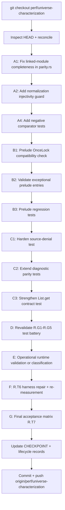

# PERF003.C2.P7 — Final Hardening and Closure Implementation Plan

## Summary

This plan brings `PERF003.C2.P7` on branch `perf/universe-characterization` to
full, verified closure. The starting commit is `fb49f61c` (`feat(perf): harden R.T5
compiler parity and certify R.G5`). The branch diverges from `main` by ~48 commits.

> [!NOTE]
> The authoritative PATCH5-R plan
> (`P7-R1/patches/PERF003.C2.P7.PATCH5-R-Luna-Patch-Grade-Implementation-Plan.md`)
> defines R.T6 and R.G6 differently from the handoff document. This plan follows
> the authoritative plan. **R.G6 is about performance harness integrity and
> evidence correctness** (valid CSV, correct BLAKE3 digest terminology, no
> failed-compile-as-success, evidence linked to the final revision, statistics
> from raw samples) — not a speedup-ratio gate. R.G7 (full regression +
> walkthrough + clean push) follows R.G6.

**Current gate status (as of `fb49f61c`):**

| Gate | Status | Evidence |
|------|--------|----------|
| R.G0 | PASS | ABI/wire-format baseline |
| R.G1 | PASS | Semantic import — exact delta 0, 264,140,626 bytes |
| R.G2 | PASS | Query reconstruction — zero delta |
| R.G3 | PASS | Failure atomicity — N-1 typed exhaustion, retry succeeds |
| R.G4 | PASS | Exact cumulative 366,789,583/366,789,583; N-1 fail; rollback |
| R.G5 | PASS | Operational compiler artifact — source-free, parity, SlotMap |
| R.G6 | **NOT CERTIFIED** | R.T6: harness integrity + re-measurement required |
| R.G7 | **NOT STARTED** | R.T7: regression matrix + walkthrough + clean push |
| P7   | IN_PROGRESS / PARTIAL / UNVERIFIED | |
| P8   | BLOCKED | |

---

## User Review Required

> [!IMPORTANT]
> **Branch checkout required before execution.**
> HEAD is currently on `main` (commit `39334961`). All implementation work must
> happen on `perf/universe-characterization`. First step: `git checkout perf/universe-characterization`.

> [!IMPORTANT]
> **Artifact file path dependency.**
> Allocation regression tests reference `PHALCOM_UNIVERSE_TELOSC_FOR_TEST`.
> The previous artifact was at `/tmp/perf003-patch5r-c7-baseline/universe.telosc`.
> The performance harness (Task F) must regenerate a fresh artifact and use it
> for all new measurements. The plan accounts for this explicitly.

> [!WARNING]
> **`main` has diverged significantly.** The branch must NOT be merged with or
> rebased onto `main` during P7 closure. Only P7-owned work goes in.

> [!CAUTION]
> **Do not modify allocation accounting constants.** The exact R.G4 baseline of
> 366,789,583 bytes is certified. Any change that legitimately alters this total
> requires independent re-measurement and re-certification before the plan can close.

---

## Open Questions

> [!IMPORTANT]
> **Non-regression investigation thresholds:** The authoritative plan specifies
> thresholds of >15% artifact-load median worsening, >15% peak RSS worsening,
> >15% warm compile worsening, and >5% artifact size change as triggers for
> investigation. Confirm these are still the accepted values before running
> characterization.

---

## Repository State

### Branch Topology

```
main (39334961) ──────────────────────────────────►
       │
  (fork point ~48 commits ago)
       │
perf/universe-characterization (fb49f61c) ────────►
```

### Whole-Load Allocation Census (Certified R.G4 Baseline)

| Stage | Ledger = Observed | Delta |
|-------|-------------------|-------|
| A — container/header | 301 | 0 |
| B — MODULE_WORLD decode | 377,691 | 0 |
| C — module materialization | 823,059 | 0 |
| D — SEMANTIC_WORLD decode | 92,338,552 | 0 |
| E — semantic native import | 264,140,626 | 0 |
| F — QUERY_IMAGE decode | 1,548,357 | 0 |
| G — METADATA decode | 1,489,834 | 0 |
| H0 — world identity setup | 13 | 0 |
| H-K — query reconstruction | 4,351,537 | 0 |
| M — metadata bundle | 1,473,434 | 0 |
| N-P — formal image publication | 245,707 | 0 |
| O — final publication | 472 | 0 |
| **Total** | **366,789,583** | **0** |

### Key Files on Branch

| File | Role | Task |
|------|------|------|
| `phalcom-core/src/modules/parity.rs` | Normalized compiler product comparator | A |
| `phalcom-core/tests/core/modules/canonical_artifact.rs` | Integration gate tests | A–F |
| `phalcom-core/tests/core/modules/parity.rs` | Comparator regression tests | A |
| `phalcom-semantic/src/prelude.rs` | `PreludeTypeMap` + `OnceLock` | B |
| `phalcom-semantic/src/canonical_image.rs` | Formal image, snapshot, prelude init | B, D |
| `phalcom-core/src/modules/canonical_artifact.rs` | `build_universe_telosc`, `load_universe_telosc` | C, E |
| `phalcom-core/examples/perf_audit_p7.rs` | Performance harness binary | F |
| `benchmarks/perf003/` | Benchmark scripts and fixtures | F |
| `docs/.../C2-compilation-performance-and-efficiency/CHECKPOINT.md` | Durable checkpoint | All |

---

## Proposed Changes

---

### Task A — Harden Compiler Product Parity

#### [MODIFY] `phalcom-core/src/modules/parity.rs`

**A1 — Linked-Module Completeness**

The current implementation (line ~219) guards linked-module comparisons with
`if let (Some(src_lm), Some(art_lm)) = (...)`. If a module is present in one
`linked.modules` map but absent in the other, the comparison silently passes.

Fix — add explicit set comparison then `match` on presence:

```diff
  let src_linked_modules: BTreeMap<ModuleId, _> = ...;
  let art_linked_modules: BTreeMap<ModuleId, _> = ...;

+ // A1: Explicitly compare linked-module identity sets.
+ let src_linked_ids: BTreeSet<_> = src_linked_modules.keys().cloned().collect();
+ let art_linked_ids: BTreeSet<_> = art_linked_modules.keys().cloned().collect();
+ if src_linked_ids != art_linked_ids {
+     report.differences.push(format!(
+         "Linked module set mismatch: only_in_src={:?}, only_in_art={:?}",
+         src_linked_ids.difference(&art_linked_ids).collect::<Vec<_>>(),
+         art_linked_ids.difference(&src_linked_ids).collect::<Vec<_>>()
+     ));
+ }

  for id in src_module_ids.intersection(&art_module_ids) {
      ...
-     if let (Some(src_lm), Some(art_lm)) = (...) {
-         // compare fields
-     }
+     match (src_linked_modules.get(id), art_linked_modules.get(id)) {
+         (Some(src_lm), Some(art_lm)) => { /* compare as before */ }
+         (Some(_), None) => report.differences.push(
+             format!("Module {:?} has linked entry in src but not art", id)
+         ),
+         (None, Some(_)) => report.differences.push(
+             format!("Module {:?} has linked entry in art but not src", id)
+         ),
+         (None, None) => {} // both absent — acceptable for canonical modules
+     }
  }
```

**A2 — Normalization Injectivity Guard**

Current `normalize_module_id` maps all synthetic project IDs to
`SyntheticProjectId::from_raw(0)`. Two distinct synthetic projects with the same
module path collapse to the same key — a silent false equality.

Fix — collision assertions before the comparisons:

```rust
assert_eq!(
    src_modules.len(), src.modules.len(),
    "normalize_module_id collision in src"
);
assert_eq!(
    art_modules.len(), art.modules.len(),
    "normalize_module_id collision in art"
);
```

> [!NOTE]
> For the known workloads (`packages/slotmap`, `packages/slotmap/tests/runtime`),
> both use file-backed project identities, so no collision occurs currently. The
> guard exists to catch future regressions.

**A3 — Comparator Completeness Inventory**

| Field | Compared | Gap? |
|-------|----------|------|
| `entry`, `initialization_order`, module key set | ✅ | — |
| `module.kind`, exports, interface fingerprint | ✅ | — |
| `module.plan.*`, all `module.lowering.*` (15 fields) | ✅ | — |
| `linked.entry`, `linked.initialization_order` | ✅ | — |
| `linked.graphs` (ref/semantic/runtime nodes + edges) | ✅ | — |
| `linked.modules` **key set** | ❌ GAP | **A1 fixes** |
| `linked.modules[*]` fields | ⚠️ partial | **A1 fixes** |
| `module.interface.imports` | ❓ | Audit needed |

**A4 — Negative Comparator Tests**

#### [MODIFY] `phalcom-core/tests/core/modules/parity.rs`

```rust
#[test]
fn comparator_detects_missing_linked_module() { ... }

#[test]
fn comparator_detects_additional_linked_module() { ... }

#[test]
fn comparator_detects_changed_module_set() { ... }

#[test]
fn comparator_detects_changed_exports() { ... }

#[test]
fn comparator_detects_changed_initialization_order() { ... }

#[test]
fn comparator_detects_changed_graph_edges() { ... }

#[test]
fn comparator_detects_changed_lowering_product() { ... }

#[test]
fn comparator_accepts_equivalent_programs() { /* prove no false positives */ }
```

**Gate A:** Negative tests fail on pre-fix code and pass after A1.
`compare_compiled_programs` on identical programs returns empty report.

---

### Task B — Harden Source-Free Prelude Initialization

#### [MODIFY] `phalcom-semantic/src/prelude.rs`

**B1 — OnceLock Compatibility Check**

Two initialization paths exist:
1. `canonical_universe()` — parses 44 Universe source files
2. `initialize_from_snapshot()` — builds from `SemanticSnapshot` (no source parse)

`OnceLock::set` fails silently if already set. If `canonical_universe()` runs
first, the snapshot-derived prelude is silently dropped.

Fix — use `get_or_init` and add a compatibility assertion:

```rust
pub fn initialize_from_snapshot(snapshot: &crate::snapshot::SemanticSnapshot) {
    let snapshot_prelude = Arc::new(Self::from_declarations(|decl| {
        snapshot.declarations.contains_key(decl)
            || snapshot.type_aliases.contains_key(decl)
            || snapshot.trait_headers.contains_key(decl)
    }));
    let existing = CANONICAL_UNIVERSE_PRELUDE.get_or_init(|| snapshot_prelude.clone());
    if existing.entries != snapshot_prelude.entries {
        panic!(
            "PreludeTypeMap: incompatible initialization — \
             entries_only_in_global={:?}, entries_only_in_snapshot={:?}",
            existing.entries.keys()
                .filter(|k| !snapshot_prelude.entries.contains_key(*k))
                .collect::<Vec<_>>(),
            snapshot_prelude.entries.keys()
                .filter(|k| !existing.entries.contains_key(*k))
                .collect::<Vec<_>>(),
        );
    }
}
```

**B2 — Prelude Declaration Completeness**

For each exceptional entry (`Duration`, `Timestamp`, `DuplicateKeyError`,
`Equivalent`, `Subtype`, `Conforms`, `Unit`) inserted without snapshot authority,
add validation:

```rust
// After building exceptional_entries, inside from_declarations:
for (name, decl) in &exceptional_entries {
    if !contains_decl(decl) {
        panic!(
            "Mandatory prelude declaration {:?} ({}) \
             not found in semantic authority",
            name, decl
        );
    }
}
```

**B3 — Regression Coverage**

#### [MODIFY] `phalcom-semantic/src/canonical_image.rs`

```rust
#[test]
fn prelude_source_artifact_equivalence() {
    // Source-derived and snapshot-derived preludes have identical entry sets.
}

#[test]
fn prelude_repeated_compatible_artifact_loads_do_not_panic() {
    // Call initialize_from_snapshot twice; compatibility check passes.
}

#[test]
fn prelude_missing_mandatory_declaration_panics() {
    // Snapshot without Unit causes panic.
}
```

> [!NOTE]
> Source-first vs. artifact-first ordering test requires a **separate OS process**
> to avoid OnceLock contamination. Use `std::process::Command` similar to
> `fresh_process_source_denied_artifact_compilation`.

**Gate B:** Prelude is deterministic, source-free on artifact path, rejects
incompatible re-initialization, and validates mandatory entries.

---

### Task C — Strengthen Source-Denial and Diagnostic Proofs

#### [MODIFY] `phalcom-core/tests/core/modules/canonical_artifact.rs`

**C1 — Source-Bootstrap Denial Hardening**

Existing `fresh_process_source_denied_artifact_compilation` (line ~612). Gaps:

1. Make SlotMap compilation **mandatory** — `packages/slotmap` absence must fail
   the test, not skip it.
2. Add **negative control** subprocess: attempt canonical source bootstrap under
   `PHALCOM_DENY_SOURCE_BOOTSTRAP=1` and assert it fails.
3. Document whether `canonical_universe_program()` and `PreludeTypeMap::canonical_universe()`
   bypass the denial instrumentation.

**C2 — Extended Diagnostic Parity**

Current test (line ~735) covers `ArgumentMismatch`. Add:

```rust
fn negative_parity_constructor_resolution_failure() { ... }
fn negative_parity_inaccessible_declaration() { ... }
fn negative_parity_invalid_pattern_matching() { ... }
fn negative_parity_trait_resolution_failure() { ... }
```

Each compiles a fixture that triggers a semantic error and asserts that
source-backed and artifact-backed engines produce matching `DiagnosticCode`,
primary span, message, and severity.

**C3 — `List<T>.get` Contract Strengthening**

Strengthen `list_get_returns_inferred_anonymous_variant_union_contract`
(canonical_image.rs:2355) to verify:
- `Some` variant identity matches canonical `Option.Some` declaration
- `None` variant identity matches canonical `Option.None` declaration
- Generic `T` is preserved through the return union

**Gate C:** Fresh-process denial proofs pass. All diagnostic parity cases agree.

---

### Task D — Revalidate Canonical State (R.G1–R.G5)

After completing A–C, re-execute the full established test battery:

```sh
RUSTFLAGS='' cargo test -p phalcom-type-meta --test allocation_helpers

RUSTFLAGS='' cargo test -p phalcom-semantic --test artifact-allocation -- \
  --nocapture --test-threads=1

RUSTFLAGS='' cargo test -p phalcom-core --test core modules_canonical_artifact:: \
  -- --test-threads=1

PHALCOM_UNIVERSE_TELOSC_FOR_TEST=/tmp/perf003-p7-fresh/universe.telosc \
  RUSTFLAGS='' cargo test -p phalcom-core --test artifact-allocation -- \
  --nocapture --test-threads=1
```

**Gate D:** All R.G1–R.G5 tests remain PASS with 366,789,583/366,789,583 delta 0.

---

### Task E — Operational End-to-End Compiler Validation

#### [MODIFY] `phalcom-core/tests/core/modules/canonical_artifact.rs`

```rust
#[test]
fn artifact_backed_slotmap_runtime_tests_execute() {
    // 1. Build artifact from source
    // 2. Load artifact (no source bootstrap)
    // 3. Compile packages/slotmap/tests/runtime (expect 8 modules)
    // 4. Execute through VM runtime entry point
    // 5. Assert exit code == 0, output matches expected
}
```

> [!CAUTION]
> If VM execution fails due to the pre-existing Class D defect (ProductKind
> source-index failure noted in C1 STATUS.md), classify explicitly with
> reproducible evidence and note in checkpoint. P7 may still close if
> compilation parity is verified and the runtime limitation is a documented
> pre-existing baseline defect.
>
> **Distinguish:** "compilation succeeded" ≠ "runtime execution passed."

**Gate E:** SlotMap compilation parity passes. Runtime execution either passes
or is explicitly classified against the accepted P7 scope with evidence.

---

### Task F — R.T6 Performance Harness Repair and Re-Measurement (→ R.G6)

> [!IMPORTANT]
> **Authoritative R.G6 definition (from PATCH5-R plan):**
> PASS iff: (1) CSV rows structurally valid, (2) raw row counts reconcile with
> child executions, (3) no failed-compile workload reported as successful, (4)
> correct BLAKE3 digest terminology used (not SHA-256), (5) measurement
> boundaries correctly separated, (6) statistics from raw samples, (7) claims
> linked to evidence from final PATCH5-R revision.
> Investigation thresholds (not failure thresholds): >15% artifact-load median,
> >15% peak RSS, >15% warm compile, >5% artifact size change.

#### [MODIFY] `phalcom-core/examples/perf_audit_p7.rs`

**R.T6.1 — CSV Escaping**

```rust
fn csv_escape(s: &str) -> String {
    if s.contains(',') || s.contains('"') || s.contains('\n') || s.contains('\r') {
        format!("\"{}\"", s.replace('"', "\"\""))
    } else {
        s.to_owned()
    }
}
```

Missing rows, nonzero child exit, unparsable output, unexpected count →
explicit typed failure, not silent skip.

**R.T6.2 — Correct Digest Terminology**

Replace any "SHA-256" references with "BLAKE3-256". Distinguish:
- Same-image serialization determinism (same in-memory state → identical bytes)
- Cross-process full-build determinism (requires identical compiler + source)

**R.T6.3 — Measurement Boundary Separation**

Separately record (not aggregated):
```
artifact_file_read_ms
container_validation_ms
section_decode_ms
semantic_relocation_ms   (native import + query reconstruction)
final_publication_ms
user_compilation_ms
vm_bootstrap_ms          (if applicable)
peak_rss_kb              (note: peak, not retained)
```

**R.T6.4 — Statistics from Raw Samples**

For each path (source-cold, artifact-cold, artifact-warm):
- 20 fresh-process samples per cold path; 10 per warm
- Compute: min / mean / median / p95 / max / stddev
- Record: git revision, artifact BLAKE3 digest, toolchain, OS/CPU, build flags

**R.T6.5 — Re-Measure PATCH5-R**

```sh
# Build release harness
RUSTFLAGS='' cargo build --release -p phalcom-core --example perf_audit_p7

# Generate fresh artifact
PHALCOM_BUILD_UNIVERSE_TELOSC=/tmp/perf003-p7-fresh/universe.telosc \
  ./target/release/examples/perf_audit_p7 generate

# Cold suite (20 samples)
./target/release/examples/perf_audit_p7 run-cold-suite \
  --artifact /tmp/perf003-p7-fresh/universe.telosc \
  --samples 20 \
  --output /tmp/perf003-p7-fresh/cold-results.csv

# Warm suite (10 samples)
./target/release/examples/perf_audit_p7 run-warm-suite \
  --artifact /tmp/perf003-p7-fresh/universe.telosc \
  --samples 10 \
  --output /tmp/perf003-p7-fresh/warm-results.csv

# SlotMap evaluation
./target/release/examples/perf_audit_p7 slotmap-eval \
  --artifact /tmp/perf003-p7-fresh/universe.telosc \
  --output /tmp/perf003-p7-fresh/slotmap-results.csv

# Allocation check (R.G4 baseline must remain 366,789,583)
./target/release/examples/perf_audit_p7 allocation-check \
  --artifact /tmp/perf003-p7-fresh/universe.telosc

# Source-denial check (R.G5 baseline)
./target/release/examples/perf_audit_p7 source-denial-check \
  --artifact /tmp/perf003-p7-fresh/universe.telosc
```

#### [NEW] `docs/.../P7-R1/PERF003.C2.P7-R.T6-performance-report.md`

Performance report containing:
- Hardware/environment (CPU, RAM, OS, Rust toolchain)
- Build flags and artifact BLAKE3 digest
- Raw sample tables (source-cold, artifact-cold, artifact-warm)
- Computed statistics per path
- Measurement boundary breakdown
- Non-regression investigation results
- R.G6 acceptance decision

**Gate F / R.G6 PASS:** Valid CSV, correct BLAKE3 terminology, no
failed-compile-as-success, evidence linked to final revision.

---

### Task G — Final Regression Matrix and P7 Acceptance (R.T7 → R.G7)

```sh
# 0. Clean branch
git checkout perf/universe-characterization && git status  # must be clean

# 1. Format check
cargo fmt --all -- --check

# 2. Compiler workspace
RUSTFLAGS='' cargo check -p phalcom-core
RUSTFLAGS='' cargo check -p phalcom-semantic

# 3. Artifact serialization
RUSTFLAGS='' cargo test -p phalcom-compiler-artifact

# 4. Semantic tests
RUSTFLAGS='' cargo test -p phalcom-semantic --lib artifact::
RUSTFLAGS='' cargo test -p phalcom-semantic --lib canonical_image::

# 5. Allocation helpers
RUSTFLAGS='' cargo test -p phalcom-type-meta --test allocation_helpers

# 6. Semantic artifact allocation
RUSTFLAGS='' cargo test -p phalcom-semantic --test artifact-allocation -- \
  --nocapture --test-threads=1

# 7. All canonical artifact integration tests (R.G1–R.G5)
RUSTFLAGS='' cargo test -p phalcom-core --test core modules_canonical_artifact:: \
  -- --test-threads=1

# 8. Comparator negative tests (Task A)
RUSTFLAGS='' cargo test -p phalcom-core --test core modules_parity::

# 9. Artifact-allocation with fresh artifact
PHALCOM_UNIVERSE_TELOSC_FOR_TEST=/tmp/perf003-p7-fresh/universe.telosc \
  RUSTFLAGS='' cargo test -p phalcom-core --test artifact-allocation -- \
  --nocapture --test-threads=1

# 10. Linker + match syntax regressions
RUSTFLAGS='' cargo test -p phalcom-modules --test linker
RUSTFLAGS='' cargo test -p phalcom-ast --test match_syntax

# 11. Broader core (catch cross-cutting regressions)
RUSTFLAGS='' cargo test -p phalcom-core --test core -- --test-threads=1
```

**Acceptance Table:**

| Category | Required | Gate |
|----------|----------|------|
| Format / whitespace | PASS | G |
| Compiler workspace check | PASS | G |
| Artifact serialization / deserialization | PASS | G |
| Semantic artifact tests | PASS | D |
| Source/artifact compiler parity | PASS | R.G5 (D) |
| Negative diagnostic parity | PASS | R.G5 (C2) |
| Source-bootstrap denial | PASS | R.G5 (C1) |
| Canonical query authority | PASS | R.G5 (D) |
| Type/static store prefix isolation | PASS | R.G5 (D) |
| Comparator negative tests (A4) | PASS | A |
| Linker / lowering regressions | PASS | G |
| R.G4 exact allocation regression | PASS | D |
| Runtime validation or classification | PASS/DOC | E |
| R.G6 performance harness | PASS | F |

#### [MODIFY] `docs/.../CHECKPOINT.md`

After all gates pass:

```yaml
status: COMPLETE
completion: COMPLETE
verification: FOCUSED_TESTED
active_plan: null
latest_completed_plan: PERF003.C2.P7.PATCH5-R
next_action: >
  P7 is COMPLETE. R.G1–R.G7 PASS.
  P8 (executable VM bootstrap) is ready for takeover.
```

Record: R.T6 + R.G6, R.T7 + R.G7, final tested revision SHA, artifact BLAKE3 digest
and size, P8 readiness prerequisites.

#### [NEW] Lifecycle Records

```
P7-R1/PERF003.C2.P7.PATCH5-R-walkthrough.md   — what actually happened
P7-R1/PERF003.C2.P7.PATCH5-R-handoff.md       — what P8 inherits
```

**Gate G / R.G7 PASS:** All acceptance rows green, CHECKPOINT updated,
lifecycle records created, branch clean and pushed.

---

## Execution Order



---

## Completion Checklist

```
IMPLEMENTATION:
[ ] A1: Linked-module completeness fix in parity.rs
[ ] A2: Normalization injectivity guard added
[ ] A4: Negative comparator tests written and passing
[ ] B1: Prelude OnceLock compatibility check implemented
[ ] B2: Exceptional prelude entries validated against snapshot
[ ] B3: Prelude regression tests passing
[ ] C1: Source-denial test hardened (mandatory SlotMap, negative control)
[ ] C2: Extended diagnostic parity tests passing (≥3 new error classes)
[ ] C3: List.get contract strengthened with typed identity checks
[ ] F:  perf_audit_p7.rs CSV escaping and BLAKE3 digest terminology fixed
[ ] F:  Measurement boundaries correctly separated in harness
[ ] F:  20 cold samples + 10 warm samples captured and CSV-validated

VERIFICATION:
[ ] D: R.G1 PASS — semantic import delta 0
[ ] D: R.G2 PASS — query reconstruction delta 0
[ ] D: R.G3 PASS — failure atomicity
[ ] D: R.G4 PASS — exact 366,789,583/366,789,583 allocation
[ ] D: R.G5 PASS — operational compiler artifact, source-free
[ ] E: SlotMap runtime PASS, or classification documented with evidence
[ ] F: R.G6 PASS — harness integrity satisfied, report published
[ ] G: All acceptance table rows GREEN
[ ] G: cargo fmt --all -- --check PASS
[ ] G: No disabled tests or weakened assertions

DOCUMENTATION:
[ ] CHECKPOINT.md updated with R.T6, R.G6, R.T7, R.G7 evidence
[ ] CHECKPOINT.md status: COMPLETE (only if all gates pass)
[ ] R.T6 performance report document created
[ ] Walkthrough record created
[ ] Handoff record for P8 created

GIT:
[ ] git diff --check PASS
[ ] No uncommitted changes
[ ] No unpushed commits
[ ] No temporary generated artifacts in tree
[ ] Branch pushed to origin/perf/universe-characterization
```

---

## Risk Register

| Risk | Severity | Mitigation |
|------|----------|------------|
| VM execution of SlotMap fails (pre-existing Class D) | Medium | Classify with evidence; P7 may close with documented limitation |
| `perf_audit_p7.rs` harness subcommands do not exist as specified | Medium | Inspect binary first; add missing subcommands if needed |
| OnceLock ordering defect surfaces in test runs | Low | Compatibility check will catch and report it clearly |
| Normalization collision in a future workload | Low | Injectivity guard panics with clear diagnostic message |
| Allocation total changes after A/B/C changes | Low | A/B/C only add test code; no production allocation paths touched |
| `packages/slotmap` path absent in test environment | Medium | C1 hardening makes it a hard failure; confirm path exists |
